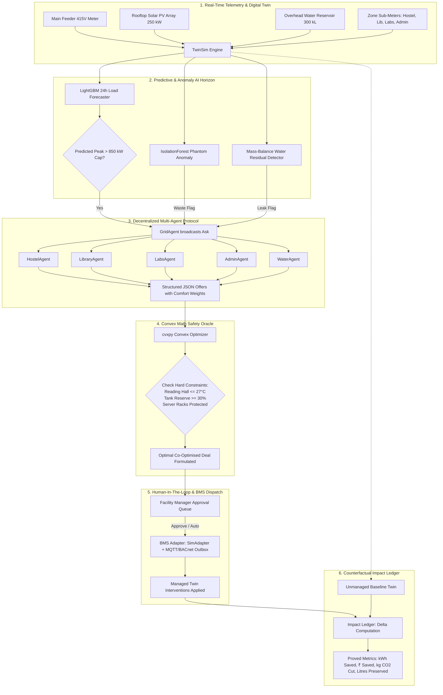

# CampusMind — AI-Powered Counterfactual Campus Digital Twin

[](#)
[](#)
[](#)
[](#)
[](#)
[](#)

> **CampusMind** is a counterfactual digital twin of a university campus where AI zone-agents negotiate load-shedding under shifting academic priorities, a convex math solver validates feasibility and guarantees safety constraints, and a live counterfactual ledger proves the exact kilowatt-hours, rupees (₹), carbon (CO₂), and litres of water saved versus doing nothing.

---

## 📌 Executive Summary & Problem Statement (PS-04)

University and institutional campuses consume massive amounts of electrical energy and potable water, yet operate on fragmented, manual, or completely unmanaged schedules. This creates **four major operational and economic crises**:

1. **Catastrophic Contract Demand Penalties:** Power distribution companies (DISCOMs) bill institutions punitive surcharges (150%–200% above base tariff) the moment grid import exceeds the contracted demand cap (850 kW). Spikes during afternoon heatwaves or simultaneous chiller start-ups cause millions in needless fines.
2. **Time-of-Day (TOD) Tariff Blindness:** Electricity during evening peak hours (18:00–22:00) costs **₹9.00/kWh** versus **₹5.50/kWh** during night off-peak. Facilities routinely run 45 kW borehole pumps and water heaters during peak hours due to lack of co-optimization.
3. **Unobserved Underground Pipe Leaks:** Sub-surface distribution bursts lose upwards of 6,000 litres/hour for days or weeks without surface signs, draining water security and running booster pumps dry.
4. **Phantom Energy Waste:** Auditoriums, lecture halls, and teaching labs regularly leave split ACs and lighting running with zero occupants after hours, wasting ~35 kW of continuous baseline power.
5. **Split Incentives & Inflexible Blackouts:** Unlike blunt breaker cuts that disrupt examinations or kill critical server rigs, **CampusMind** treats every campus building as an intelligent economic agent capable of expressing real human comfort constraints.

---

## 🔄 End-to-End System Workflow



---

## 🧮 Mathematical Formulation (The Solver)

Rather than allowing generative LLMs to directly dispatch actuators to physical hardware (which risks hallucinations and safety violations), **CampusMind** adopts the architecture: **"LLMs propose intent; a convex solver guarantees physics."**

For each deficit trigger with target shed requirement $R$, the convex optimizer solves:

$$\min_{s_{z,l}} \sum_{z \in \mathcal{Z}} \sum_{l \in \mathcal{L}_z} w_{z,l} \cdot \frac{s_{z,l}^2}{\text{max\_shed}_{z,l}}$$

$$\text{subject to:}$$
1. **Demand Deficit Satisfaction:** $\sum_{z,l} s_{z,l} \ge R$
2. **Physical Headroom Bounds:** $0 \le s_{z,l} \le \text{max\_shed}_{z,l}$
3. **Hydraulic Continuity:** $\text{Reserve}_{\text{tank}}(t + \Delta t) \ge \text{MinReserve}_{\text{pct}} \times \text{Capacity}_{\text{kl}}$
4. **Thermal Setpoint Limits:** $T_{\text{zone}} + \Delta T_{\text{offset}} \le T_{\text{comfort\_floor}}$ (e.g. Reading halls $\le 27.0^\circ\text{C}$)

Where:
* $s_{z,l}$ is the power shed allocated to zone $z$ under lever $l \in \{\text{hvac}, \text{lighting}, \text{flexible}, \text{pump}\}$.
* $w_{z,l} = \text{base\_weight}_{z,l} \times \text{comfort\_multiplier}_z$.
* When **Exam Week** is active, the Library agent increases its comfort multiplier from $1.4 \to 2.8$, automatically directing the quadratic solver to spread load shedding toward Admin and Hostel non-essential circuits without human reprogramming.

---

## 🏗 Architecture & Repository Layout

```
kaushal-hackathon-8.0/
├── backend/
│   ├── main.py             # FastAPI REST gateway + WebSocket /ws broadcast
│   ├── config.py           # Configuration schema, MPSERC tariffs & India grid factor
│   ├── models.py           # Pydantic models (TwinState, Ask, AgentOffer, Deal, FeedMessage)
│   ├── ledger.py           # Real-time counterfactual differential math & Monte Carlo bands
│   ├── approvals.py        # HITL deal approval state machine & tamper-evident audit log
│   ├── sim/
│   │   ├── engine.py       # TwinSim twin lockstep simulation engine
│   │   ├── zones.py        # Zone thermal physics, ASHRAE-55 HVAC model & rebound queues
│   │   ├── water.py        # Hydraulic reservoir balance, Grundfos pump model & leak dynamics
│   │   ├── solar.py        # Solar PV GHI irradiance to electrical conversion
│   │   ├── weather.py      # Open-Meteo cache client (Indore coordinates: 22.7°N, 75.8°E)
│   │   └── scenarios.py    # Chaos stressor injection engine
│   ├── ml/
│   │   ├── datagen.py      # 60-day physics-grounded synthetic historical telemetry
│   │   ├── forecast.py     # LightGBM GBDT 24h regressor (MAPE 1.75%)
│   │   └── anomaly.py      # IsolationForest phantom waste & hydraulic mass-balance rules
│   ├── agents/
│   │   ├── orchestrator.py # 2-round decentralized negotiation protocol
│   │   ├── prompts.py      # System prompts with hard constraints & persona boundaries
│   │   ├── fallback.py     # Deterministic calibrated BMS rule-based fallback agents
│   │   └── llm.py          # Structured JSON client (Gemini / OpenAI / Anthropic / Mock)
│   ├── solver/
│   │   └── verify.py       # cvxpy convex allocation solver with OSQP / ECOS backends
│   └── adapters/
│       └── bms.py          # BACnet / MQTT hardware protocol stub adapter
├── frontend/
│   ├── src/
│   │   ├── App.tsx         # Neo-Brutalist dashboard, live WS state, HITL drawer
│   │   ├── index.css       # Design tokens, dotted grid, neo-brutalist utility classes
│   │   ├── components/
│   │   │   ├── CampusMap.tsx       # 2D schematic SVG Digital Twin with live load styling
│   │   │   ├── NegotiationFeed.tsx # Real-time agent chat stream with telemetry tags
│   │   │   ├── DealCard.tsx        # Structured deal review cards & solver math diffs
│   │   │   ├── LedgerPanel.tsx     # 5 big animated counters & Recharts baseline curves
│   │   │   ├── ChaosPanel.tsx      # 5 live chaos stress testing injection cards
│   │   │   ├── ForecastTab.tsx     # LightGBM 24h load forecast with annotated peak cap
│   │   │   ├── OtherTabs.tsx       # Anomalies, Audit Trail, BMS Outbox & Architecture Workflow
│   │   │   └── AssetDetailDrawer.tsx # Contextual telemetry panel for selected assets
├── data/
│   ├── timetable.csv       # Hourly occupant timetable schedule across 4 zones
│   ├── weather_cache.json  # Cached Open-Meteo solar irradiance and temperatures
│   └── history.parquet     # 60-day simulated training dataset
├── tests/
│   └── test_campusmind.py  # Comprehensive pytest verification suite (9 tests)
└── Makefile                # One-command automation script
```

---

## ⚡ Quick Start & Installation

### Prerequisites
* **Python 3.10+**
* **Node.js 18+** and **npm**

### Method 1: One-Command Start (`Makefile`)
```bash
make demo
```
This automatically sets up Python virtual environments, installs requirements, seeds telemetry data, trains the LightGBM forecaster, and launches both backend and frontend servers.

### Method 2: Manual Terminal Launch

**Terminal 1 — Backend:**
```powershell
# Create & activate venv
python -m venv .venv
.venv\Scripts\Activate.ps1

# Install dependencies
pip install -r requirements.txt

# Run server
python -m uvicorn backend.main:app --host 127.0.0.1 --port 8000
```

**Terminal 2 — Frontend:**
```powershell
cd frontend
npm install
npm run dev
```

Open **http://localhost:5173** in your web browser.

---

## 🎛 3-Minute Live Demo Walkthrough (For Judges & Evaluators)

| Time | Stage | Action & Key Talking Point |
|---|---|---|
| **0:00 - 0:30** | **The Baseline Twin** | Open dashboard. Point out the 2D digital twin: Hostels, Library, Labs, Admin, Solar Array, and Water Tank. The campus is running at nominal 620 kW import—comfortably below the **850 kW Contract Demand Limit**. |
| **0:30 - 1:15** | **The Crisis (Chaos Button)** | Click **HEATWAVE INJECTION (+8°C)** in the Chaos Panel. The LightGBM forecaster immediately recalculates; predicted peak spikes to **945 kW (breaching the 850 kW cap)**. Within seconds, GridAgent broadcasts an **Ask**, and the Negotiation Feed streams live offers from zone agents. |
| **1:15 - 1:45** | **LLM Proposes, Solver Disposes** | Show the pending **Deal Card**. Expand the **Solver Math Verification Diff**. Point out: *"The LLM proposed shedding 40 kW in the Library, but the convex solver clamped it to 28 kW to protect the 27°C reading hall comfort ceiling."* Click **APPROVE**. |
| **1:45 - 2:15** | **Counterfactual Proof** | Look at the **Impact Ledger Chart**. Watch the green line (Managed Twin) drop below the red cap line, while the pink line (Unmanaged Baseline) spikes into penalty territory. Confetti bursts; counters for **₹ Saved**, **kWh Saved**, and **CO₂ Cut** increment with live confidence intervals. |
| **2:15 - 2:40** | **Academic Context (Exam Week)** | Click **EXAM WEEK SCHEDULE**. Comfort floor weights jump to $w=2.8$. Library and Hostels refuse deep cuts. The solver shifts shedding to Administrative conference rooms and pausable batch GPU compute in Labs. |
| **2:40 - 3:00** | **The Water-Energy Nexus** | Click **WATER TANK PIPE LEAK**. The residual anomaly detector identifies an unobserved 6 kL/h breach within 3 ticks. WaterAgent generates a valve branch isolation deal. Switch to the **BMS Outbox Tab** to show the real BACnet/MQTT JSON payload ready for physical PLCs. |

---

## 🧪 Automated Testing & Verification

Run the complete test suite:
```powershell
pytest
```
```
============================== 9 passed in 1.77s ==============================
```

### Verified Test Matrix:
* `test_determinism`: Asserts identical 24-hour baseline sequences given identical seed (`SEED=42`).
* `test_calibration`: Asserts normal baseline stays below 850 kW; Heatwave reliably exceeds cap by 8–15%.
* `test_solver_feasible_and_weights`: Confirms convex optimization spreads burden to low-comfort-weight zones.
* `test_solver_infeasible`: Confirms graceful degradation and partial allocation when headroom is insufficient.
* `test_ledger_savings`: Proves counterfactual differential is strictly zero with no interventions and positive with deals (including rebound).
* `test_fallback_agents`: Validates offline deterministic rule-based offers without network access.
* `test_api_smoke`: Tests state, forecast, and scenario REST endpoints.
* `test_negotiation_message_uniqueness`: Regression test asserting strictly unique 32-hex message IDs across rounds.
* `test_sim_reset_lifecycle`: Tests clean teardown and reset of clock, feeds, and ledger history.

---

## 🔌 API & WebSocket Reference

### REST Endpoints (`/api`)
| Method | Endpoint | Description |
|---|---|---|
| `GET` | `/api/health` | Backend status, LLM mode, and model loading state |
| `GET` | `/api/state` | Full state snapshot of baseline and managed twins |
| `POST` | `/api/sim/control` | Control sim clock: `{"action": "play" \| "pause" \| "speed" \| "reset"}` |
| `POST` | `/api/scenario` | Inject chaos stressor: `{"type": "heatwave" \| "exam_week" \| "grid_outage" \| "tank_leak" \| "phantom_load" \| "reset"}` |
| `GET` | `/api/forecast` | LightGBM 24h load forecast with MAPE metric |
| `GET` | `/api/anomalies` | Active phantom load and water leak anomalies |
| `GET` | `/api/ledger` | Cumulative counterfactual metrics and 28-point history |
| `GET` | `/api/ledger/confidence` | Monte Carlo P10 / P50 / P90 confidence bounds |
| `GET` | `/api/deals` | List all formulated deals |
| `POST` | `/api/deals/{id}/approve` | Human-in-the-loop approval and BMS dispatch |
| `POST` | `/api/deals/{id}/reject` | Reject formulated deal |
| `GET` | `/api/audit` | Tamper-evident audit log |
| `GET` | `/api/bms/outbox` | Dispatched BACnet / MQTT command payload queue |
| `POST` | `/api/demo/script` | Deterministic demo insurance execution |

### WebSocket Endpoint (`/ws`)
Broadcasts real-time events:
* `initial_state`: Sent immediately upon client connection.
* `tick`: Emitted every 15 simulation minutes with updated telemetry and ledger summary.
* `feed_message`: Live streaming negotiation messages.
* `deal_update`: Deal status transitions (`pending` $\to$ `approved` $\to$ `applied`).
* `anomaly`: Immediate anomaly alert emissions.
* `feed_reset`: Resets feed history during simulation restarts.

---

## ⚖️ Disclosures & Data Attribution

1. **Weather Telemetry:** Weather inputs (dry-bulb temperature, shortwave solar radiation) are derived from the public [Open-Meteo API](https://open-meteo.com) for Indore, India (22.7196°N, 75.8577°E). An offline cache is embedded in `data/weather_cache.json` for 100% offline operation.
2. **Campus Model:** Campus power loads, HVAC thermal response curves, and water distribution networks are modeled through physics-based differential equations calibrated to standard Indian institutional benchmarks.
3. **Tariffs & Emissions:** Tariffs follow Madhya Pradesh Electricity Regulatory Commission (MPERC) Time-of-Day schedules (Peak ₹9.00/kWh, Normal ₹7.00/kWh, Off-Peak ₹5.50/kWh). Grid carbon emission intensity is calibrated to Central Electricity Authority (CEA) India baseline factor of **0.82 kg CO₂/kWh**.
4. **Autonomous AI Assistance:** This software was designed and developed during the Hackathon utilizing AI pair-programming systems (Google DeepMind Antigravity).
